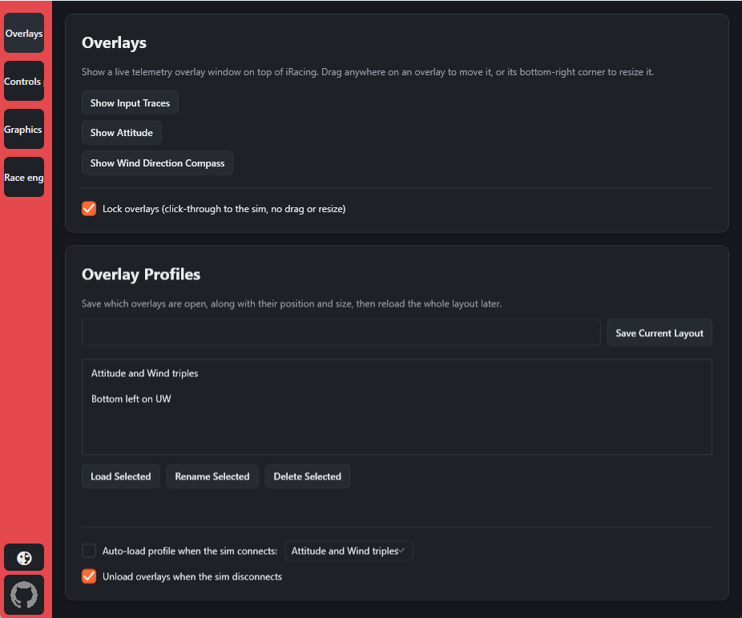
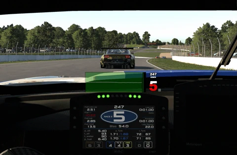
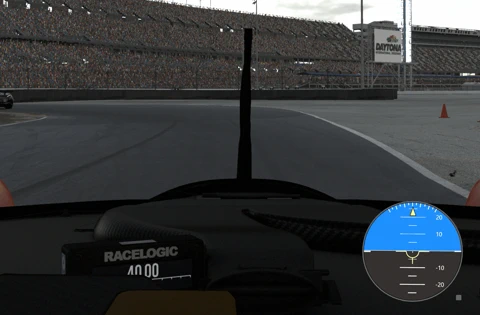
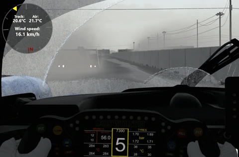
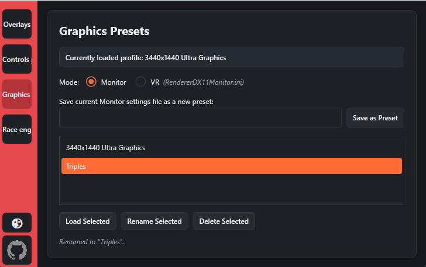
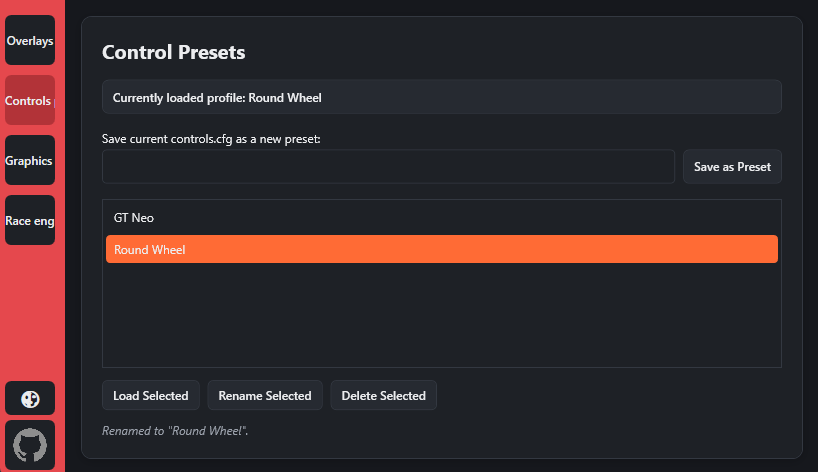

# Quick Release Overlays  
A supplementary application for iRacing  that provides customizable real-time telemetry overlays and preset management. Built with WPF and .NET 10, QRO allows drivers to display pedal input traces, attitude indicators, and wind speed+directional data during racing sessions. Additionally supports creating graphics and controls presets. Currently working on implementing AI powered race engineer that will provide setup advice based on user feedback.

[Video showcase of overlays.](https://www.youtube.com/watch?v=JXRrDOsghEY)

## Overlays
### Overlay Selection and Presets
 

### Pedal Input Traces
 

### Attitude Indicator
 

### Wind Speed and Direction
 

## Preset Manager
### Graphics Presets
 

### Controls Presets (Deprecated)
 

 

<em>Functionality added to iRacing as of [June 9, 2026](https://support.iracing.com/support/solutions/articles/31000179016-2026-season-3-initial-release-notes-2026-06-09-01-).</em>

